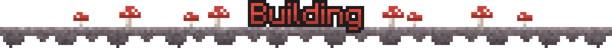

<p align="center">
  
</p>

<p align="center">
  <a href="https://www.curseforge.com/minecraft/mc-mods/advancement"></a>
  <a href="https://www.curseforge.com/minecraft/mc-mods/advancement/files"></a>
  
  
  
  <a href="https://www.curseforge.com/minecraft/mc-mods/mycel"></a>
  <a href="https://wiki.mycelium-gg.org/advancements/"></a>
  <a href="https://github.com/MyCelium-GG/Advancements/blob/main/LICENSE"></a>
</p>


`config/advancements.json`, reload live with `/mycel reload advancements`.

| Key | Default | Meaning |
|---|---|---|
| `enabled` | `true` | Master switch. |
| `showTracker` | `true` | Show the overlay. |
| `trackerPosition` | `above_hotbar` | `above_hotbar`, `top_left` or `top_right`. |
| `untrackWhenDone` | `true` | Drop the overlay a few seconds after the advancement is done. |
| `clickForDetails` | `true` | Clicking an advancement opens its window. |
| `sounds` | `true` | Sounds for progress, finishing and opening the window. |

Which advancement has the overlay is saved per world and server in `config/advancements-tracked.json`.


Anonymous usage stats (windows opened, which advancements get the overlay, settings, and errors in this mod's
code) go to its FastStats project through Mycel, following Mycel's one-time choice in your game.
[Details](https://wiki.mycelium-gg.org/privacy#stats-advancements).



JDK 25, then:

```sh
./gradlew build            # all loaders + tests
./gradlew :common:test     # unit tests only
./gradlew build -Pmc=26.1  # the 26.1 or 26.2 line
```
