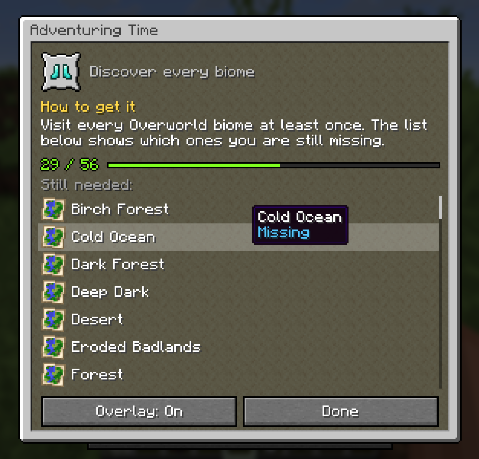
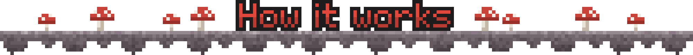
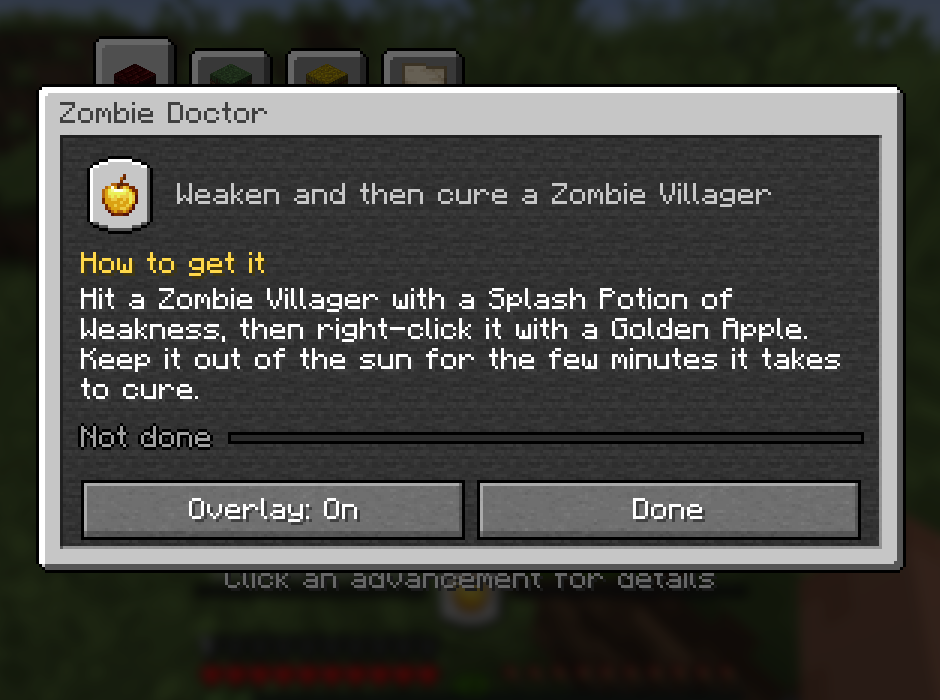
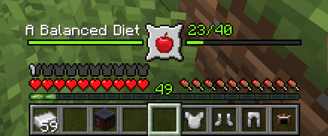
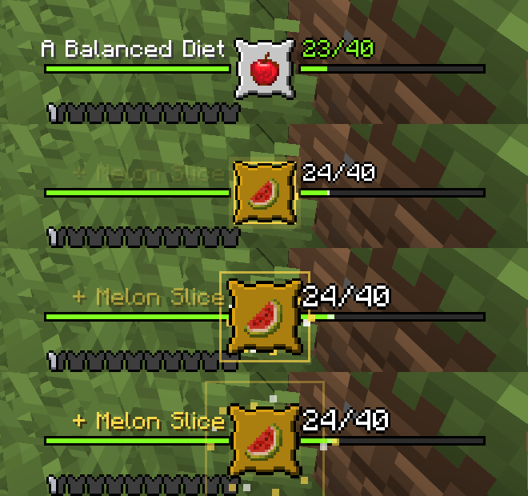
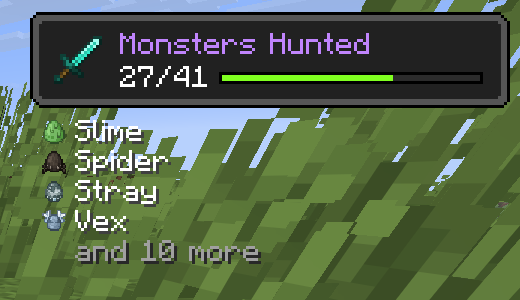

# Advancements


Vanilla tells you "Discover every biome", but not which ones you are missing.
Advancements does. Click any advancement in the advancements screen and a small
window explains **how to get it**, shows how far along you are and lists
exactly **what is still missing**: every biome, food, mob, cat or wolf variant.
Turn on its **overlay** and follow it while you play, right above your hotbar.



Built on [Mycel](https://github.com/MyCelium-GG/MyCel-Lib) (`my.celium.org`), the shared
core for the MyCelium ecosystem.

| | |
|---|---|
| Mod id | `advancements` |
| Minecraft | **26.3**, **26.2**, **26.1** (26.1-26.1.2) · Java **25** |
| Loaders | Fabric, Forge, NeoForge |
| Side | Client only: works in singleplayer and on any server, vanilla ones included |



- **Click an advancement** in the advancements screen (**L**) to open its
  window. Dragging the tree and switching category tabs work as before.
- **How to get it**: a written explanation for every one of Minecraft's 126
  advancements (what to do, where, and a tip where one helps). Advancements
  from other mods and data packs show their own description.
- **Still needed**: every missing part with its icon, then the parts you have
  in gold. Hover one you have to see when you got it.
- **Overlay**: turn it on for one advancement per world or server. It sits
  above your hearts and food with the advancement's frame in the middle and
  its progress bar to both sides, and steps aside for the held item's name and
  action bar messages. Or put it in a top corner as an advancement toast.
- **Animation and sounds**: every new part pops the frame, bursts a gold ring
  and sparks, fades in `+ Melon Slice` and plays a chime that climbs in pitch.
  Finishing gets a bigger celebration, then the overlay shrinks away.











Advancements sends anonymous stats (how often windows are opened, which
advancements get the overlay, the settings, and errors in its own code) to its
FastStats project through Mycel. It follows Mycel's choice exactly: the
one-time screen in your own game. Details:
https://wiki.mycelium-gg.org/privacy#stats-advancements


Settings live in `config/advancements.json`.

| Key | Default | Meaning |
|---|---|---|
| `enabled` | `true` | Master switch. |
| `showTracker` | `true` | Show the overlay. |
| `trackerPosition` | `above_hotbar` | `above_hotbar`, `top_left` or `top_right`. |
| `untrackWhenDone` | `true` | Drop the overlay a few seconds after the advancement is done. |
| `clickForDetails` | `true` | Clicking an advancement opens its window. |
| `sounds` | `true` | Sounds for progress, finishing and opening the window. |

Reload live with `/mycel reload advancements`. Which advancement has the
overlay is saved per world and server in `config/advancements-tracked.json`.


JDK 25, then:

```sh
./gradlew build            # all loaders + tests
./gradlew :common:test     # unit tests only
./gradlew build -Pmc=26.1  # the 26.1 or 26.2 line
```
